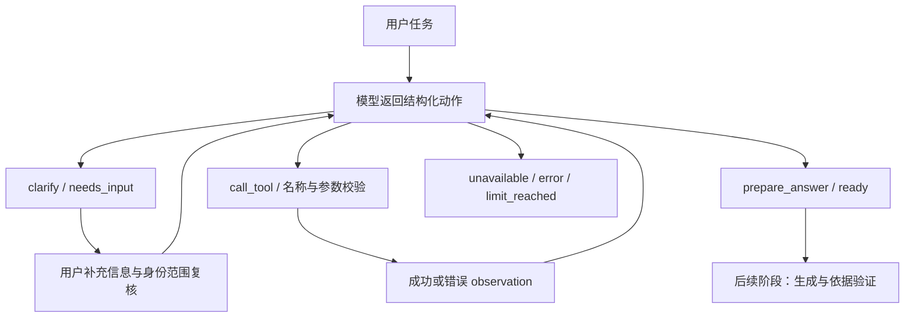

# Agent 第一阶段：通用任务编排

历史阶段状态：后端编排核心完成后暂停并获用户继续授权。现已完成[第二阶段](agent-stage2.md)的实际知识库、日期/计算工具、答案依据验证和 API，以及[第三阶段页面接入](agent-stage3.md)；本页保留第一阶段当时的范围与验证记录。

## 已实现的能力

| 能力 | 实现与效果 |
| --- | --- |
| 通用任务理解 | 模型区分 `knowledge_question` 与 `business_task`，输出简短目标；没有请假、报销或采购专用分支。 |
| 缺失信息追问 | `clarify` 返回最多三个问题，暂停执行。服务器通过 `resume` 传入用户回复后继续，保留问题与回复的对应关系。 |
| 动态工具选择 | `call_tool` 每轮选择一个已注册工具；服务器严格校验名称和参数，再调用 Python handler。工具结果作为数据返回给下一轮模型。 |
| 结果交接 | `prepare_answer` 只能引用本任务成功的 observation；返回 `ready`。它表示可以进入下一阶段，不表示答案已生成、经过验证或业务已获批准。 |
| 明确无法完成 | 缺少工具、缺少证据或任务超出范围，返回 `unavailable` 和结构化原因。模型/API 出错则返回 `error`。 |
| 执行上限 | 默认整个任务最多 8 次规划、6 次工具调度、4 次用户输入；追问后继续不会重置计数。另有上下文和工具输出大小限制。 |
| 去重与错误处理 | 对校验后的工具名/参数计算摘要，阻止重复执行。失败结果不能当作成功证据；异常保留服务端 traceback，模型只接收安全错误码。 |
| 任务隔离 | 无全局对话历史。继续任务时要求服务器身份及权限范围版本一致，否则在调用模型前拒绝。 |
| Provider 与指标 | 复用现有 HTTP Client 和 Generator 配置，新增 `planner` 调用角色；记录规划/工具耗时、token 和按配置单价估算的费用。 |
| 语言与日期基准 | 接收 zh/ja/en、明确的参考日期和时区；相对日期在任务内采用同一参考日期。 |

核心文件：[编排与工具接口](../backend/agent.py)、[Provider](../backend/providers.py)、[自动化测试](../tests/test_agent.py)。本阶段未增加依赖或安装 LangGraph。

## 执行状态



规划器通过现有兼容 API 的 JSON object 模式工作，并由 Pydantic 再检查严格 schema；不会把 JSON 可解析等同于字段正确，也不会自动执行模型输出的任意函数。协议依据见 [OpenAI Structured Outputs / JSON mode](https://developers.openai.com/api/docs/guides/structured-outputs)。

## 验证证据

- [动态本地回归报告](../reports/tests.md)：数量由 JUnit 自动生成；跳过的 PostgreSQL 用例不计为通过。本阶段没有声称重新完成 Docker/远程 CI 验收。
- [真实 Planner 检查](../reports/agent-stage1/planner-smoke-live.json)：采购（中）、差旅（日）、入职（英）进入 `ready`；通勤补助（中）进入 `needs_input`，追问雇佣类型和现场办公天数。
- 上述检查调用真实配置模型，工具返回显式 `mock` 的虚构规定。它只验证规划、工具调度和追问，**没有运行 Embedding、真实知识检索、最终回答或 Claim Grounding**，不能当作完整 Agent 的准确率评估。
- [检查数据](../evals/agent-planning-smoke.json) 为 AI 编写、未经人工审核的小规模 fixtures；通过状态断言不代表覆盖了模型的所有决策错误。原始输出和费用见 JSON。
- 首次受限网络运行的 [连接失败记录](../reports/agent-stage1/planner-smoke-sandbox-failed.json) 保留，未知费用未按零计算。取得联网权限后完成真实模型检查。

可复现命令：

```powershell
.\.venv\Scripts\python.exe -m pytest -q tests/test_agent.py tests/test_providers.py
.\.venv\Scripts\python.exe -m ruff check .
.\.venv\Scripts\python.exe -m ruff format --check .
.\.venv\Scripts\python.exe -m scripts.check
# 显式 opt-in：会消耗 API 额度，只发送虚构 fixtures
.\.venv\Scripts\python.exe -m scripts.agent_planner_smoke --live --output reports/agent-stage1/planner-smoke-live.json
```

## 后续接入约束

1. `AgentState` 仅供服务器内部使用，不能从浏览器上传的 JSON 重建可信状态。HTTP 会话存储、过期和并发控制尚未接入；同一 state 的操作必须串行执行。
2. `AgentContext.principal_id` 和 `scope_revision` 必须由服务器计算。当前的版本比较是接入点，不是新的 ACL resolver；第二阶段必须复用现有权限/版本过滤，在 Planner/检索前确定范围，继续任务时重新检查权限及索引/配置变化。
3. `ReadOnlyTool` 是开发者注册的可信 Python handler 接口，不是代码沙箱。服务器必须只注册审核过的只读实现；模型不能注册工具或构造 handler。不得把数据库权限或鉴权参数交由模型填写。
4. 工具结果标记 `retrieved/calculated/live/mock`。最终答案需要分别关联政策原文、工具结果和用户自述，再进行依据验证；本阶段只交接证据，没有把任何未经验证的业务判断展示给用户。
5. 调用次数、字符数量有限制；字符不是 token，不能当作精确费用上限。Provider 保留现有重试与 HTTP 超时；本阶段尚无能够中断在途同步请求的任务总时限。
6. 工具输出中的指令作为不可信数据处理，但提示词不是完整的注入防护保证。当前测试确认未注册工具无法执行；真实工具的最小权限和检索隔离还需要第二阶段集成测试。

下一阶段：接入现有 RAG Knowledge Search、日期和计算工具，并完成基于工具/文档证据的结果生成。页面与完整多场景演示放在第三阶段。
