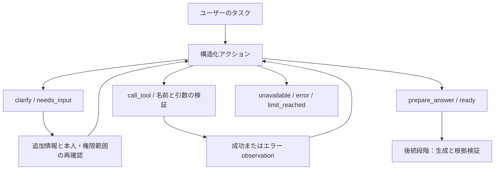

# Agent 第 1 段階：汎用タスクの実行制御

過去の段階記録です。バックエンド中核完成後に停止し、依頼者の続行指示を受けました。現在は[第 2 段階](agent-stage2.md)の実検索・日付/計算・回答検証・API と[第 3 段階の画面](agent-stage3.md)を完了しています。本書は第 1 段階当時の範囲と結果を維持します。

## 実装した機能

| 機能 | 実装と効果 |
| --- | --- |
| 汎用的な意図理解 | knowledge_question / business_task を区別して短い目的を出力。休暇・精算・購入の専用分岐なし |
| 不足情報の質問 | clarify が最大 3 問を返して停止。resume で返信を渡し、質問との対応を保持して続行 |
| 動的ツール選択 | call_tool が毎回 1 登録ツールを選択。サーバーが名前・引数を厳格検証し Python handler を実行。結果をデータとして次のモデルへ |
| 結果の引き継ぎ | prepare_answer は同じタスクの成功 observation のみを参照し ready を返す。次段階へ進める意味で、回答生成・検証・業務承認済みではない |
| 実行不能の明示 | ツール・根拠不足や範囲外は unavailable と構造化理由、モデル/API 異常は error |
| 実行上限 | タスク全体で計画 8 回、ツール 6 回、ユーザー入力 4 回。再開でリセットせず、文脈とツール出力も制限 |
| 重複・エラー | 検証済み名前・引数のハッシュで重複実行を防止。失敗を成功根拠にせず、サーバーに traceback、モデルには安全なエラーコードのみ |
| タスク分離 | グローバル会話履歴なし。再開時にサーバー ID と権限範囲の版が一致しなければ、モデル呼び出し前に拒否 |
| Provider と計測 | 既存 HTTP Client と Generator 設定を再利用し planner 役割を追加。計画・ツール時間、token、設定単価の費用を記録 |
| 言語と日付 | zh/ja/en、明示的基準日・タイムゾーンを受け取り、相対日付は同一タスク内で同じ基準日を使用 |

[実行制御・ツールインターフェース](../backend/agent.py)、[Provider](../backend/providers.py)、[テスト](../tests/test_agent.py)。この段階では依存追加や LangGraph 導入はありません。

## 実行状態



互換 API の JSON object モードを使い、Pydantic で厳密 schema を再検証します。JSON が解析可能なだけで正しいフィールドとは扱わず、任意のモデル出力関数も実行しません。参考：[OpenAI Structured Outputs / JSON mode](https://developers.openai.com/api/docs/guides/structured-outputs)。

## 検証の証跡

- [動的ローカル回帰結果](../reports/tests.md)：JUnit から生成し、PostgreSQL skip は成功としません。この段階で Docker/遠隔 CI を再検収したとは主張しません。
- [実 Planner 確認](../reports/agent-stage1/planner-smoke-live.json)：購入（中国語）、出張（日本語）、入社（英語）は ready、通勤補助（中国語）は needs_input となり、雇用形態と出社日数を質問。
- 設定した実モデルを使用しますが、ツールは明示的 mock の架空制度を返します。計画・選択・質問のみを検証し、**Embedding、実検索、最終回答、Claim Grounding は未実行**。Agent 全体の精度評価ではありません。
- [確認データ](../evals/agent-planning-smoke.json)は AI 作成の未レビュー少数 fixture。状態の通過は全判断誤りの網羅を保証しません。元出力・費用は JSON。
- 初回の制限ネットワークによる[接続失敗](../reports/agent-stage1/planner-smoke-sandbox-failed.json)も保持。不明費用をゼロ扱いせず、接続許可取得後に実モデルを確認しました。

再現：

```powershell
.\.venv\Scripts\python.exe -m pytest -q tests/test_agent.py tests/test_providers.py
.\.venv\Scripts\python.exe -m ruff check .
.\.venv\Scripts\python.exe -m ruff format --check .
.\.venv\Scripts\python.exe -m scripts.check
# 明示的 opt-in：API 利用枠を消費し、架空 fixture のみ送信
.\.venv\Scripts\python.exe -m scripts.agent_planner_smoke --live --output reports/agent-stage1/planner-smoke-live.json
```

## 後続の接続条件

1. `AgentState` はサーバー内部専用で、ブラウザーの JSON から信頼状態を再構築できません。当時は HTTP 状態保存・期限・並行制御は未接続で、同一 state の操作は直列にします。
2. `AgentContext.principal_id` と `scope_revision` はサーバーが計算します。版比較は接続口で、新 ACL resolver ではありません。第 2 段階で既存権限・版フィルターを再利用し、Planner/検索前に範囲を確定、再開時に権限・索引・設定を再確認します。
3. `ReadOnlyTool` は開発者登録の信頼済み Python handler インターフェースで、コード sandbox ではありません。確認済み読み取り実装のみ登録し、モデルに登録・handler 構築・DB 権限・認証引数を委ねません。
4. ツールを retrieved/calculated/live/mock と分類。最終回答は制度、ツール、自己申告を別々に関連付け検証します。当時は根拠の引き継ぎのみで、未検証業務判断を表示しません。
5. 回数・文字数を制限しますが、文字数は token ではなく厳密な費用上限ではありません。Provider の再試行・HTTP timeout は維持し、送信中同期要求を中断するタスク総 timeout は未実装でした。
6. ツール内の指示は非信頼データとして扱いますが、プロンプトだけで注入対策は完結しません。未登録ツールの実行不可は確認済み。実ツールの最小権限と検索分離は第 2 段階で結合検証します。

次は RAG Knowledge Search、日付・計算、根拠付き生成を接続し、画面と複数シナリオのデモは第 3 段階で扱います。
