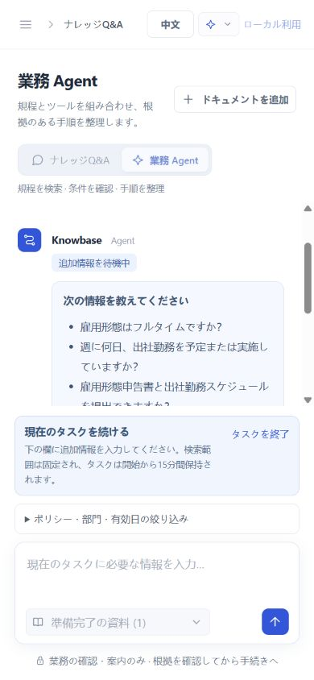

# Agent 第 3 段階：画面・複数ターン・根拠表示

この段階の実装とローカル検収を完了し、依頼どおり停止した時点の記録です。前 2 段階の汎用制御、ツール、厳密検証をチャット画面から利用できます。

## 使い方

`python run.py` で起動し `http://127.0.0.1:8000/` を開いて **業務 Agent** を選択。テキスト層があり、索引済みでアクセス可能な PDF と API モードを用意します。通常の知識 Q&A は既存 RAG API を使います。

目的と既知条件を入力すると回答または追加質問が出ます。待機中は同じ入力欄から返信できます。文書範囲変更や別件開始時は **タスク終了** または **新しい Q&A** を選びます。判断・手続きの案内のみで、申請提出や外部操作は行いません。

## 変更と効果

| 変更 | 効果 |
| --- | --- |
| 汎用入口 | 知識 Q&A / 業務 Agent を切替。購入・研修・条件確認は例示で、休暇専用ではない |
| 複数ターン | needs_input で質問・タスク表示。追加文だけを元タスクに送り、Planner 文脈を再構築しない |
| 範囲ロック・取消 | 実行・待機中は文書・フィルター・モードをロック。取消成功後のみハンドルを削除。404 は終了、409/通信失敗は再試行可能な状態を保持 |
| 3 種の出典 | 文書、ツール、ユーザーを分離。PDF の物理ページ、演算引数・結果、自己申告が業務システム未確認であることを表示 |
| 実行記録 | バックエンドの実ツール成功・失敗、質問、検証のみ表示。同期要求完了後に表示し、リアルタイム動作を偽装しない |
| 検証状態 | 引用・主張チェック失敗は遮断状態のみで、候補は非表示。Mock と自己申告の制約を維持 |
| 中国語・日本語とレスポンシブ | モード、質問、エラー、出典、ツール項目、記録を両言語化。モデル回答・原文は維持。390px の画面で横方向のはみ出しなし |
| ログイン分離 | ログアウトでメッセージ、下書き、フィルター、出典、タスクを消去。遅い旧応答は復元せず、旧要求の 401 は新 ID をログアウトさせない。task は localStorage に保存しない |
| 検証 | Node 内蔵テストで振り分け、再開、取消、失効、競合、ID 分離、XSS エスケープ、出典分類。CI に動的フロントエンド結果を追加 |

[Agent 画面](../dist/agent.js)、[チャット統合](../dist/app.js)、[認証・権限 UI](../dist/governance.js)、[スタイル](../dist/styles.css)、[フロントエンドテスト](../tests/frontend/agent.test.cjs)。

## 実ブラウザー確認

隔離 SQLite と[架空制度](../evals/agent-workflows.json)で PDF を実再索引し、Embedding、Planner、Generator、Verifier に設定した実モデルを使用。元の利用者文書は変更していません。gpt-5.6-luna / text-embedding-3-small の少数機能確認で、未レビューかつ独立品質 benchmark ではありません。

| 画面シナリオ | 実際の観測 | この入力の時間 |
| --- | --- | ---: |
| 中国語の購入 | Search + Calculator、3 × 1200 = 3600 円。5/5 主張通過、3 種の出典と実行記録を確認 | 22.52 秒 |
| 日本語の補助・追加確認 | フルタイム、出社日数、書類を質問。範囲ロックし、同じタスクへ返信 | 8.67 秒 |
| 日本語の補助・再開 | **Strict に不合格で 1/4 主張のみ通過し、回答は非表示。** 待機を解除して遮断状態を表示 | 15.74 秒 |
| 日本語の研修 | Calendar が 2026-10-12 の 3 暦日前を 2026-10-09 と計算し、必要書類を列挙。4/4 主張通過 | 16.50 秒 |
| 日本語の既存 RAG | 通常 Q&A に戻り研修書類と PDF 2 ページ目を正しく引用。1/1 通過 | 4.98 秒 |
| 中国語の取消 | モデルの質問後に終了。サーバー取消成功で終了表示し、範囲・モードを解放 | 質問 4.99 秒 |

日本語再開は UI と遮断フローの正しさを確認したもので、業務回答の成功ではありません。当時は Generator 誤りと Verifier 誤拒否を未分類で、後続校正で独立診断する予定でした。strict を弱めて成功にしていません。出力には変動があり、第 2 段階の 4 成功も毎回の成功を保証しません。

[ブラウザー使用量](../reports/agent-stage3/browser-api-metrics.json)に、プレビュー開始後の索引と 6 入力を記録。遮断・質問も含む推定合計 **USD 0.01279446**。単価は設定値で請求書ではなく、返信待ちはモデル時間から除外。初回 sandbox の索引接続失敗後、許可を得て sandbox 外で起動し UI から再索引しました。

保存した画面原文：[日本語の質問・遮断](../reports/agent-stage3/ja-clarification-result.txt)、[日付](../reports/agent-stage3/ja-calendar-result.txt)、[RAG 回帰](../reports/agent-stage3/ja-rag-regression.txt)、[取消](../reports/agent-stage3/zh-cancel-result.txt)。

## 検収と当時の制約

- `python -m scripts.check_frontend` が TAP から件数を生成。[JSON](../reports/agent-stage3/frontend-tests.json)、[元 TAP](../reports/agent-stage3/frontend-tests.tap)。Node.js 24 が必要で npm 依存なし。
- Python・カバレッジは[動的結果](../reports/tests.md)。ローカル PG 未設定による skip は成功に含めません。Ruff check/format とフロント 3 スクリプトの構文検査が通過。
- ブラウザーの console error はなし。自動テストは未手動再現の ID 切替、401、404、409、悪意ある出典本文も対象。
- CI にフロントテストを追加しましたが、この段階では新 Agent の遠隔 CI、Docker、PostgreSQL 通過を主張していません。
- リロードでローカル会話・ハンドルを失い、サーバー待機は作成から 15 分。プロセス再起動で無効。終了ボタンは待機のみを取り消し、進行中モデル要求を中断しません。
- 営業日カレンダーは明示的 Mock。HR、実カレンダー、外部書き込み、Agent 承認、Human-in-the-loop は追加していません。

