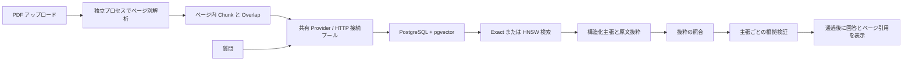

# Knowbase の構成と実行規約

## 文書と質問応答

SQLite は外部 DB が不要な開発モードと比較用に維持します。`RAG_DATABASE_URL` 設定時は統一 Store 経由で PostgreSQL に文書 metadata、設定、native vector を保存し、PDF 原本は永続ファイルボリュームに置きます。既存 SQLite は自動移行せず、明示的コマンドで移行します。Compose の既定は PostgreSQL + pgvector です。

## Provider とライフサイクル

アプリごとに単一 `OpenAICompatibleProvider` を作り、接続プール付き `httpx.Client` を保持します。索引、回答、根拠検証、接続テストで共有し、モデル設定とキーは毎回明示的に渡して共有 Client の既定認証は変えません。API 実装は `backend/providers.py` に集約し、Client/MockTransport や互換オブジェクトを注入可能です。終了時は索引タスクを停止後、Provider と DB プールを閉じます。

`Metrics` は索引・質問ごとに作成し、並行操作の使用量を混ぜません。生成と根拠検証を別計測し、再試行・バックオフも全体時間に含めます。失敗で usage がなければ費用不明で、ゼロとは扱いません。100 万 token あたりの設定単価による推定で請求額ではなく、サービス・モデル変更時は単価も更新します。

参考：[Embedding](https://developers.openai.com/api/reference/resources/embeddings/methods/create)、[Chat Completions](https://developers.openai.com/api/reference/resources/chat/subresources/completions/methods/create)。互換サービスは `/embeddings`、`/chat/completions`、JSON object 応答に対応する必要があります。通常の接続テストは 2 モデルの応答確認のみで、構造化 RAG の全互換性は `scripts/live_smoke.py` で検証します。

## 引用と回答状態

Generator は `status` と `claims` を返します。`insufficient_evidence` は空 claims、`answered` は各主張に `source_id` と原文 quote が必要です。サーバーは検証済み claims のみ表示し、追加の自由回答は表示しません。拒否文中の特定文字列には依存しません。

既定 strict は schema、出典 ID、抜粋を検証し、Verifier が数値、条件、範囲、有効日、否定を確認します。1 主張でも支持不足、結果欠落、形式不正なら全回答を非表示にします。fast は構造・抜粋、off は構造・ID のみで、意味的根拠は未検証と明示します。未実行を成功に数えません。API は status、support、claims と UI 互換の refused を返します。

Generator/Verifier は別設定で、Verifier が空なら Generator を再利用。strict は追加モデル要求 1 回で、verification 時間・費用を別記録します。抜粋チェックとモデル判定であり形式的証明ではありません。同じモデルには相関する誤りがあり、別モデルでも真実性は保証しません。Evaluation Judge は別設定で参照回答・gold evidence から採点し、実行時通過フラグを引き継ぎません。遮断候補は明示的な内部評価専用で、公開回答から隠します。

## 保存・索引・デプロイの境界

pgvector の既定は Exact、HNSW は明示選択です。native vector の HNSW は最大 2,000 次元（[公式資料](https://github.com/pgvector/pgvector#hnsw)）、local hash は 2,048 次元なので local は Exact。ベクトルを切り詰めて同じモデルと装いません。設定と実次元で分離し、HNSW 初回構築と事前実行後の検索時間を別報告。ANN は Exact に対する recall も報告します。

索引処理は単一プロセス。`RAG_AUTH_MODE=required` がユーザー・ロール・文書 ACL、local は明示的な単一ユーザー開発です。SSO、ユーザー監査、分散タスクは未実装。Compose はホストのループバックだけにアプリを公開します。DB とファイルは一緒にバックアップします。ログは実 traceback、文書 ID、段階、索引 ID を記録し、UI は読みやすいエラーを表示。キーやリクエスト本文は積極的に記録しません。

物理ページ境界の理由と代償は [ADR 0001](adr/0001-physical-page-chunks.md)。

HNSW は書き込みトランザクション、起動・設定保守時に作成し、検索は存在確認のみ。advisory lock で直列化し、アプリ名前空間の不要 profile 索引だけ整理します。Exact は index/bitmap scan を、HNSW は sequential/bitmap scan と sort を無効にして、通常索引＋sort を ANN と誤認しないようにします。比較は実 SQL の `EXPLAIN DECLARE` でカーソル計画を確認し、ef_search=100/400/1000 の再現率・時間を測ります。アプリは ef_search=100。再現率不足なら Exact を使います。

新規 Compose は init-db がランダムパスワードを専用永続ボリュームに生成し、DB と非 root App が読み取ります。再起動で再利用し、.env なしでも local が起動します。CI は実 pgvector を skip ゼロで検証後、コンテナー構築、PDF 索引、引用、再起動保持を確認します。通常テストとモデル HTTP は分離し、CI は API 利用枠を使いません。

## 検索と権限の拡張

`principal → role/owner ACL → requested IDs + metadata predicates → query embedding → dense + lexical → RRF → optional reranker → generator → quotes + verifier → citations`。全モデル呼び出し前に権限を解決し、PDF/Chunk/文書管理にも同じ境界を適用します。[アクセス制御](access-control.md)、[検索と検証 ADR](adr/0002-hybrid-and-verification.md)、[Agent 導入条件](adr/0003-agent-gates.md)を参照してください。

## 汎用 Agent と実ツール

`backend/agent.py` は独立した中核として、入力 → JSON 判断 → 質問 / 読み取りツール / 根拠引き継ぎ / 実行不能を制御します。サーバー登録のツール名・引数・結果を検証し、予算を複数ターンで共有。本人・範囲の版変更で旧タスク継続を拒否します。Planner は既存 Provider と Generator モデルを再利用し、役割・時間を別記録します。

`backend/agent_service.py` が /api/agent、返信、取消を提供し、短期状態をユーザーに紐付けます。各モデル操作前に本人・文書範囲・設定を確認し、権限や根拠の変化で停止。Knowledge Search は既存検索、日付・金額は決定的ツール、最終回答は answer_from_sources の引用・主張検証を再利用します。Agent は strict/all 固定。文書・ツール・自己申告を区別し、Mock を確認済み企業日暦と解釈できません。

Planner と生成側の両方で追加質問できます。ready は生成へ進む意味で、検証・承認済みではありません。第 1 段階は模擬ツールのみ、[第 2 段階](agent-stage2.md)で実 PDF→Embedding→検索→日付/計算→生成/検証を完了。[第 3 段階](agent-stage3.md)がチャット入口を提供します。メモリ会話は単一プロセスのみで再起動で失効します。

`dist/agent.js` は要求振り分け、一時ハンドル、出典分類を担当。待機中はモード・文書・metadata を固定し、返信は新本文だけ。ハンドルと会話を localStorage に書きません。ログアウト時に文脈を消去してクライアントの ID 世代を進め、遅い応答・401 による旧データ復元や新セッション解除を防ぎます。実際の権限・状態はサーバーが確認。記録は同期応答内の実イベントで、リアルタイム進行の偽装やモデルの内部推論の表示はしません。ツール・自己申告に PDF リンクはなく、文書リンクはローカル文書 ID と物理ページから構築します。
