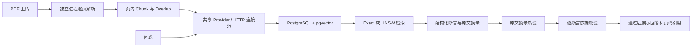

# Knowbase 架构与运行约定

## 文档与问答

SQLite 保留为无需数据库的开发模式和比较基线。配置 `RAG_DATABASE_URL` 后应用经统一 Store 接口使用 PostgreSQL：文档元数据、配置和原生 vector 全部进入 PostgreSQL；PDF 原件保存在持久文件卷。不会自动迁移已有 SQLite 数据，迁移使用显式命令。Docker Compose 默认运行 PostgreSQL + pgvector。

## Provider 与生命周期

每个应用实例创建一个 `OpenAICompatibleProvider`，持有带连接池的 `httpx.Client`。索引、问答、依据校验和连接测试均复用它；每次调用显式传入模型配置和密钥，不修改共享 Client 的默认鉴权。API 服务只实现于 `backend/providers.py`，可通过注入 Client/MockTransport 或同接口对象替换。应用关闭时先停止索引任务，再关闭 Provider 和数据库连接池。

`Metrics` 按每次索引或问答创建，避免并发操作混用用量。生成与依据校验分别计时；重试及退避也计入整体延时。失败请求没有返回 usage 时，其费用可能未知，不把未知费用当作 0。费用按用户配置的每百万 token 单价估算，不是账单；更换服务或模型时需同步更新单价。

API 协议参考：[Embedding](https://developers.openai.com/api/reference/resources/embeddings/methods/create) 与 [Chat Completions](https://developers.openai.com/api/reference/resources/chat/subresources/completions/methods/create)。兼容服务需支持 `/embeddings`、`/chat/completions` 和 JSON object 响应。普通连通测试只检查两个模型能返回结果，完整结构化 RAG 兼容性由 `scripts/live_smoke.py` 验证。

## 引用与回答状态

生成模型必须返回 `status` 和 `claims`。`insufficient_evidence` 必须伴随空 claims；`answered` 必须包含逐项断言及其 `source_id` 和原文 quote。服务器只渲染经过校验的 claims，不展示额外的自由文本答案。业务逻辑不再匹配拒答文本里的任何特殊字符串。

先检查 schema、来源 ID、原文摘录，再用一次独立 LLM 调用判断引用的完整片段是否支持每条断言的数字、条件、范围及否定。任意断言未获支持、校验结果不完整或格式错误，整条生成答案停止展示。API 返回 `status`、`support` 和 `claims`，同时保留 `refused` 供现有界面兼容。

这是“精确摘录检查 + 模型判断”，不是形式化证明。同一模型的第二次调用仍可能有相关性错误、受到提示注入或误判，需要独立标注数据与人工核查；不能把通过率当作真实性保证。它会增加一次模型请求的费用与延时，实验报告单独计入 verification。

## 存储、索引与部署边界

精确检索是 pgvector 的默认路径；HNSW 是显式选择。原生 vector 的 HNSW 有 2,000 维上限（[官方文档](https://github.com/pgvector/pgvector#hnsw)），本地哈希向量是 2,048 维，因此本地模式使用 exact；不得截断向量冒充相同模型。配置和实际维度都参与隔离。HNSW 初次建索引成本与热查询延时需分开报告，近似检索必须报告相对 exact 的 recall。

本应用仍是单用户、单索引进程的原型。数据库换成 PostgreSQL 不等于完成组织权限或分布式任务调度；Compose 默认只在宿主机回环地址发布应用端口。数据库和文件卷需要一起备份。日志记录真实 traceback、文档 ID、处理阶段和索引身份；前端仍显示可读错误，日志不主动记录 API 密钥或请求正文。

物理页边界的决定、理由和代价见 [ADR 0001](adr/0001-physical-page-chunks.md)。
