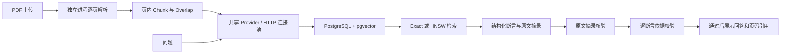

# Knowbase 架构与运行约定

## 文档与问答

SQLite 保留为无需数据库的开发模式和比较基线。配置 `RAG_DATABASE_URL` 后应用经统一 Store 接口使用 PostgreSQL：文档元数据、配置和原生 vector 全部进入 PostgreSQL；PDF 原件保存在持久文件卷。不会自动迁移已有 SQLite 数据，迁移使用显式命令。Docker Compose 默认运行 PostgreSQL + pgvector。

## Provider 与生命周期

每个应用实例创建一个 `OpenAICompatibleProvider`，持有带连接池的 `httpx.Client`。索引、问答、依据校验和连接测试均复用它；每次调用显式传入模型配置和密钥，不修改共享 Client 的默认鉴权。API 服务只实现于 `backend/providers.py`，可通过注入 Client/MockTransport 或同接口对象替换。应用关闭时先停止索引任务，再关闭 Provider 和数据库连接池。

`Metrics` 按每次索引或问答创建，避免并发操作混用用量。生成与依据校验分别计时；重试及退避也计入整体延时。失败请求没有返回 usage 时，其费用可能未知，不把未知费用当作 0。费用按用户配置的每百万 token 单价估算，不是账单；更换服务或模型时需同步更新单价。

API 协议参考：[Embedding](https://developers.openai.com/api/reference/resources/embeddings/methods/create) 与 [Chat Completions](https://developers.openai.com/api/reference/resources/chat/subresources/completions/methods/create)。兼容服务需支持 `/embeddings`、`/chat/completions` 和 JSON object 响应。普通连通测试只检查两个模型能返回结果，完整结构化 RAG 兼容性由 `scripts/live_smoke.py` 验证。

## 引用与回答状态

生成模型必须返回 `status` 和 `claims`。`insufficient_evidence` 必须伴随空 claims；`answered` 必须包含逐项断言及其 `source_id` 和原文 quote。服务器只渲染经过校验的 claims，不展示额外的自由文本答案。业务逻辑不再匹配拒答文本里的任何特殊字符串。

默认 `strict` 检查 schema、来源 ID、摘录，再由 Verifier 检查数字、条件、范围、有效日期及否定。任意断言未获支持、结果不完整或格式错误，整条答案停止展示。`fast` 只做结构和摘录检查，`off` 只做结构和来源 ID 检查；两者明确返回语义依据未验证，不把未执行的验证计为通过。API 返回 `status`、`support` 和 `claims`，保留 `refused` 兼容界面。

Generator 与 Verifier 模型分别配置，Verifier 留空时复用 Generator。strict 增加一次模型请求，单独记录 verification 时间与费用。这是摘录检查加模型判断，不是形式化证明；同一模型的两次调用有相关错误，换模型也不能保证真实性。Evaluation Judge 另行配置，用参考答案和 gold evidence 评分，不继承运行时通过标志。被拦截候选只供显式内部评估误拒答，公开回答隐藏候选内容。

## 存储、索引与部署边界

精确检索是 pgvector 的默认路径；HNSW 是显式选择。原生 vector 的 HNSW 有 2,000 维上限（[官方文档](https://github.com/pgvector/pgvector#hnsw)），本地哈希向量是 2,048 维，因此本地模式使用 exact；不得截断向量冒充相同模型。配置和实际维度都参与隔离。HNSW 初次建索引成本与热查询延时需分开报告，近似检索必须报告相对 exact 的 recall。

本应用仍使用单索引进程。`RAG_AUTH_MODE=required` 提供用户/角色/文档 ACL；`local` 是显式单用户开发模式。尚无 SSO、用户审计或分布式任务调度；Compose 默认只在宿主机回环地址发布应用端口。数据库和文件卷需要一起备份。日志记录真实 traceback、文档 ID、处理阶段和索引身份；前端仍显示可读错误，日志不主动记录 API 密钥或请求正文。

物理页边界的决定、理由和代价见 [ADR 0001](adr/0001-physical-page-chunks.md)。

HNSW 在写入事务或启动/设置维护时建立，查询只验证索引存在。生命周期操作用 advisory lock 串行化，只清理应用命名空间中的废弃 profile 索引。Exact 禁用 index/bitmap scan；显式 HNSW 禁用 sequential/bitmap scan 和排序，避免普通索引加排序冒充 ANN。基准通过生产 SQL 的 `EXPLAIN DECLARE` 检查游标查询计划，并比较 ef_search=100/400/1000 的召回和延时。应用 ef_search=100，真实召回不达标时应继续使用 Exact。

全新 Compose 启动由 init-db 服务生成随机密码，存入独立持久卷。数据库与非 root App 只读该文件，重启复用，无需 `.env` 即可运行 local 模式。CI 要求真实 pgvector 测试零跳过，再构建容器、索引示例 PDF、检索引用并检查重启持久性。模型 HTTP 与普通测试隔离，CI 不消耗 API 额度。

## 检索与权限升级

`principal → role/owner ACL → requested IDs + metadata predicates → query embedding → dense + lexical → RRF → optional reranker → generator → quotes + verifier → citations`。权限范围在所有模型调用之前解析，PDF/分块/文档管理也使用同一权限边界。参见 [访问控制](access-control.md)、[检索与验证 ADR](adr/0002-hybrid-and-verification.md)、[未来 Agent 门槛](adr/0003-agent-gates.md)。

## 通用 Agent 编排与实际工具

`backend/agent.py` 提供独立的任务编排核心：用户输入 → JSON 决策 → 追问 / 只读工具调度 / 证据交接 / 无法完成。工具由服务器注册，名称、参数和结果均校验，执行预算贯穿多轮追问；身份或权限范围版本变化会阻止继续使用旧任务。Planner 复用现有 Provider 和 Generator 模型，独立记录调用角色与耗时。

`backend/agent_service.py` 提供 `/api/agent`、任务回复与取消接口，服务器持有用户绑定的短期任务状态。每次模型操作前重新检查身份、文档范围与配置，权限/证据变化后停止旧任务。Knowledge Search 复用现有检索，日期/金额使用确定性工具，最终通过 `answer_from_sources` 复用引用及断言验证。Agent 固定 strict/all，文档、工具和用户自述分别标记来源，模拟日历不能被解释为已确认的企业日历。

Planner 与生成阶段都可以追问；`ready` 只表示进入结果生成，不代表已验证或业务已批准。第一阶段检查只调用模拟工具，[第二阶段检查](agent-stage2.md)已实际完成 PDF→Embedding→检索→日期/计算→生成/验证。[第三阶段](agent-stage3.md)通过聊天页提供完整入口；内存会话只适用于当前单进程应用，重启失效。

`dist/agent.js` 负责请求路由、临时任务句柄和分类证据显示。任务等待补充时锁定模式、文档与 metadata 筛选，回复请求仅上传新文本。句柄与对话不写入 localStorage。退出登录时清除上下文并递增客户端身份代次，迟到的响应或 401 不得恢复旧数据或退出新会话；真正的权限与状态仍由服务器检查。执行记录来自响应中的实际事件，在同步请求结束后展示，不模拟实时进度或暴露模型推理。工具、自述来源没有 PDF 链接，文档链接由本地文档 ID 和物理页码构造。
