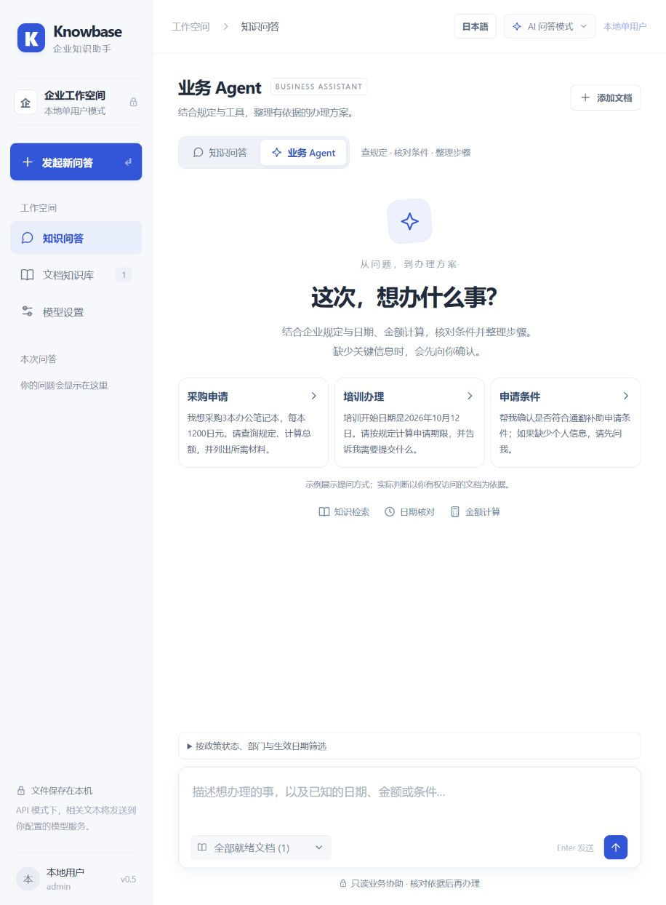
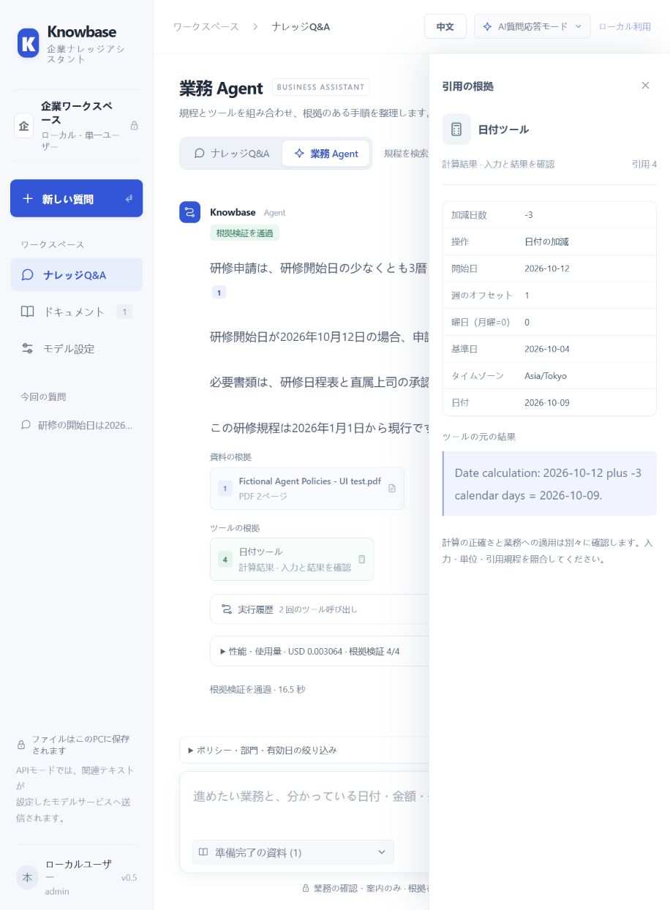
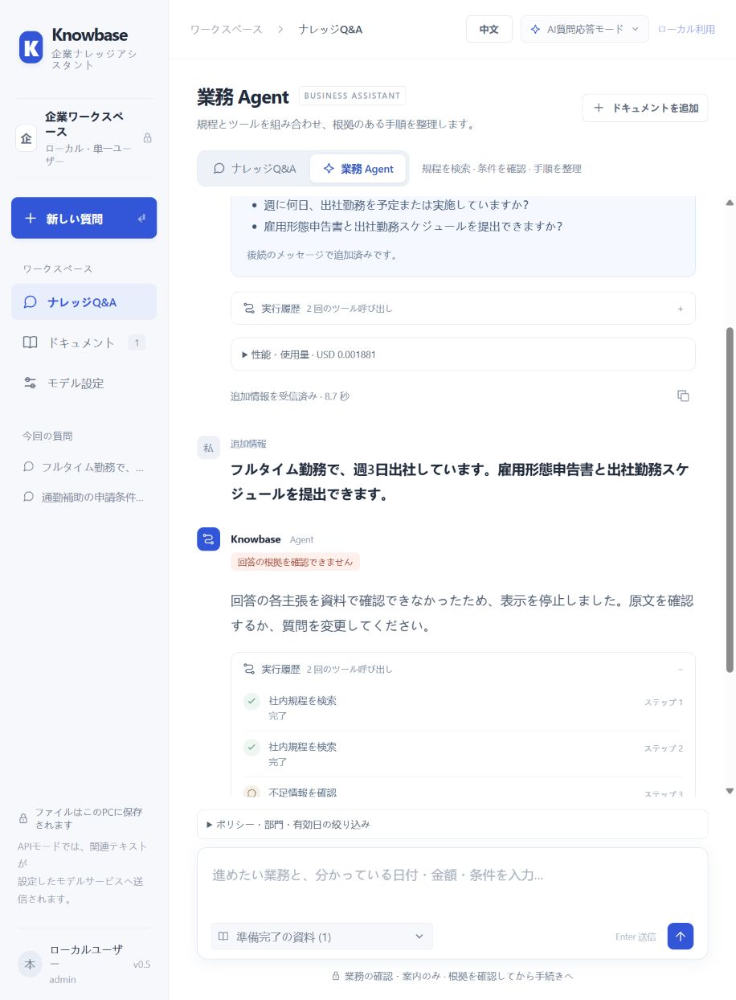

# 2 分間のデモ手順

これは録画用の台本で、収録済み動画ではありません。既存画像は第 3 段階の実ブラウザー結合検証、最終スコアは `9af3637` の凍結評価です。両者を同じ実行結果として扱わないでください。展示時はターミナル、キー、トークン、個人用ブラウザータブを隠します。

| 時間 | 画面 / 操作 | 説明 |
|---|---|---|
| 0:00–0:20 | README と構成図 | 企業 PDF 検索と読み取り専用 Agent。中国語・日本語、ページ引用に対応 |
| 0:20–0:45 | 架空資料に「出張精算にはどの書類が必要ですか？」と質問 | 原文、回答の引用、PDF 物理ページを表示。local 検索か API 回答かを明示 |
| 0:45–1:15 | Agent に「1 個 1,200 円の商品を 3 個購入します。PROC-26 ではどの手続きが必要ですか？」 | ナレッジ検索と計算ツール。サーバーが結果を描画し、3,600 円であることは承認済みを意味しない |
| 1:15–1:35 | 日本語に切り替え「業務委託で週4日出社しています。通勤補助を申請できる制度ですか？」 | 同じ権限内の日本語回答、出典、拒否の境界。実際の承認機能があるとは説明しない |
| 1:35–2:00 | 凍結レポートと CI を開く | Task Success 18/24、正確性 / 根拠支持 13/18、P50/P95 12.189/24.922 秒、6 件の失敗。Mock カレンダー、自動 Judge、単一プロセスの制約 |

API 出力には確率的な変動があります。録画中に拒否や失敗が起きた場合は、そのまま説明し、架空の成功に差し替えません。API 未設定時は検索と過去の結果ページのみを録画し、「過去の結果の紹介」と明示します。

## 既存の画面例

### Agent 初期画面（過去の結合検証）

### 日本語の追加確認とツールの根拠（過去の結合検証）

### Strict による回答拒否（過去の結合検証）

画像は UI と動作の例であり、凍結した 24 問がすべて成功したことを示しません。[第 3 段階の検収](agent-stage3.md)を参照してください。
